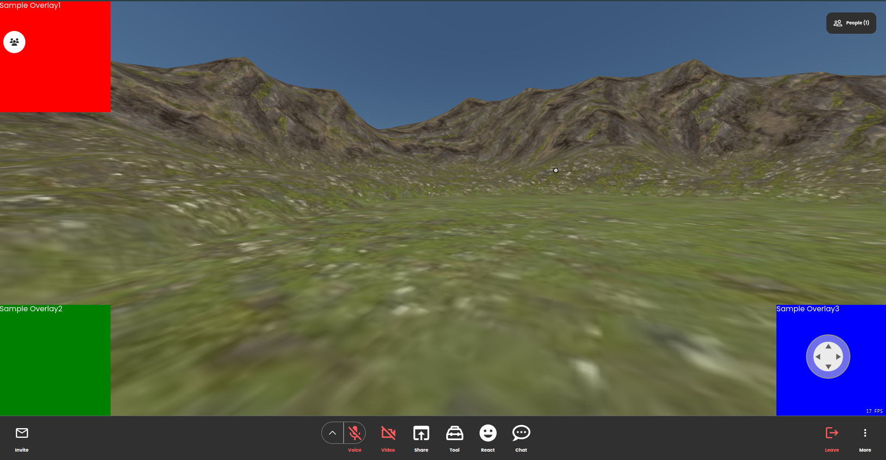

# CustomOverlay template

## Description

This is a template for creating a CustomOverlay for `metatell`.

CustomOverlay allows you to create a custom overlay for the `metatell` application.

Bellow screenshot are the example of custom overlay:

<p align="center">
  
</p>

## Interface

```tsx
type CustomOverlayProps = {};
```

CustomOverlay has no props.

## Pre-requisites

- Node.js 24
- pnpm 12

## Scripts

- `pnpm dev`: Start the development server
- `pnpm build`: Build the project
- `pnpm preview`: Preview the production build locally
- `pnpm test`: Run unit tests (Vitest)
- `pnpm lint`: Run format, lint, and type checks (`vp check`)
- `pnpm lint-fix`: Fix format and lint issues (`vp check --fix`)

## How to develop

1. Install dependencies

install the dependencies by running the following command:

```
pnpm install
```

2. Run the development server

Run the following command to start the development server:

the development server will start at http://localhost:3004

```
pnpm dev
```

3. update package.json to add metadata

Update the package.json file to add metadata about the CustomOverlay. The metadata includes the name, description, and the version of the plugin.

You can update the following fields to the package.json file:

```json
{
  "name": "my-cool-custom-overlay",
  "version": "0.0.1",
  "description": "A custom overlay"
}
```

4. Build the project

Run the following command to build the project:

```
pnpm build
```

You can find the built files in the `dist` directory.

5. Publish the project

You can upload the plugin from `metatell-admin` dashboard.

## Tips

### Restrictions

- do not use default export. export Component as named export
- component name should be `CustomOverlay`
- component should be placed in `src/CustomOverlay` directory
  - You can change the directory by updating federation config in `vite.config.ts`

### Styling ecosystem

You can use CSS Modules without any additional configuration.

If you want to use different styling systems like styled-components, you can do so by installing the required packages.
